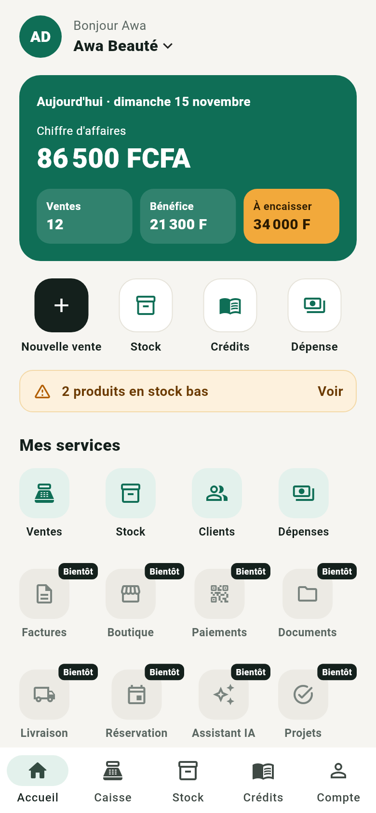
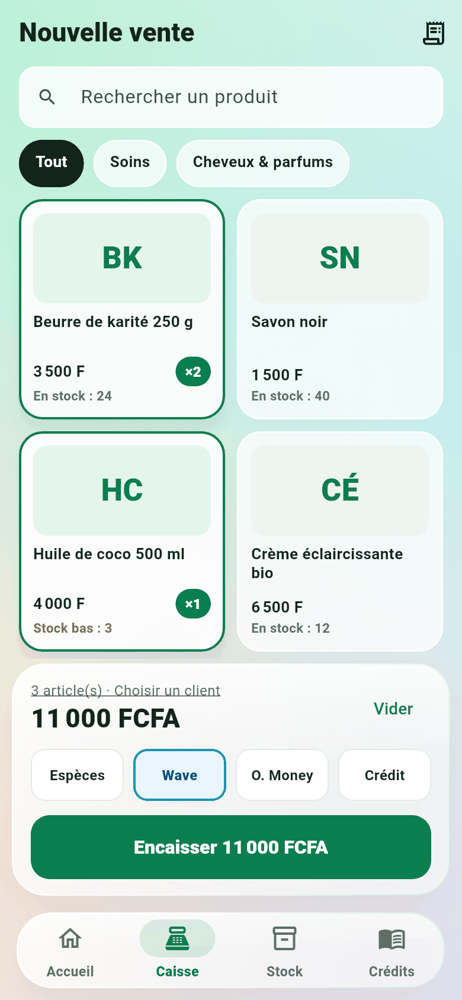
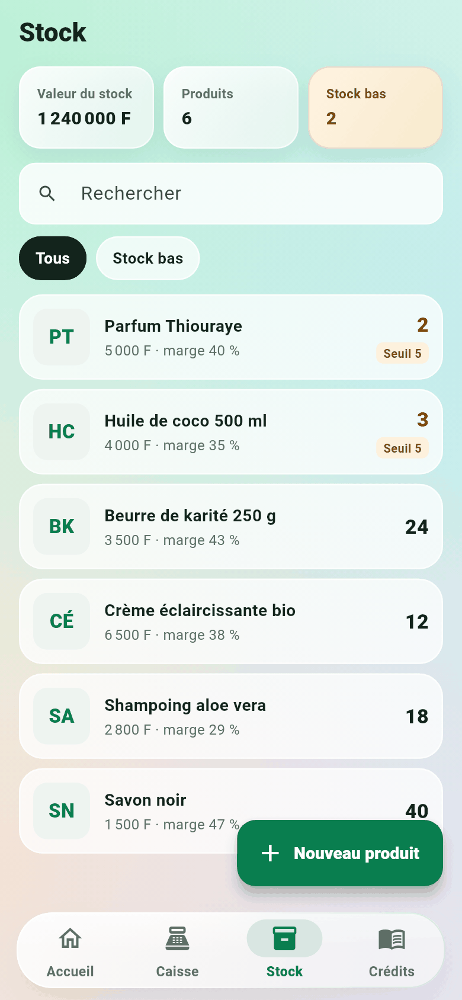
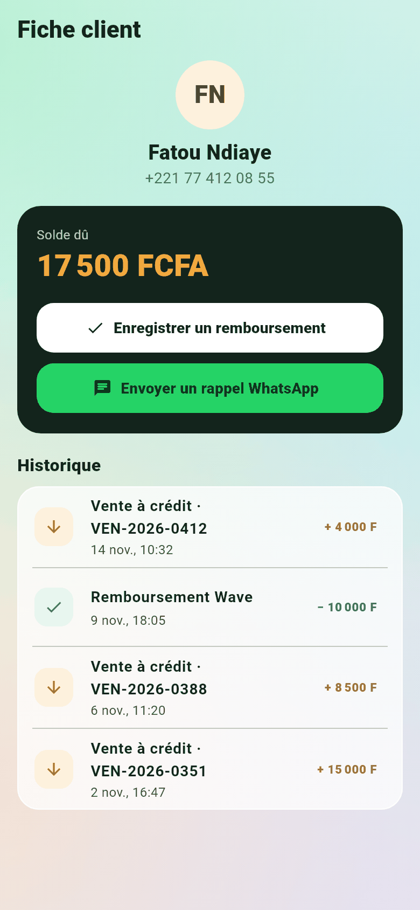

# Sama360 — app mobile (Flutter)

Application des commerçants : connexion par SMS, accueil avec le résumé du jour, caisse,
stock, carnet de crédit. Elle parle à l'API de `apps/api`.

| Accueil | Caisse | Stock | Carnet de crédit |
| --- | --- | --- | --- |
|  |  |  |  |

## Prérequis

- **Flutter 3.47 ou plus récent** (`flutter --version` ; sinon `flutter upgrade`).
- L'API et le worker lancés (`pnpm dev` et `pnpm worker` à la racine du dépôt).
- Un émulateur Android, ou un téléphone Android en mode développeur.

## Lancer l'app

```bash
cd apps/mobile
flutter pub get

# Chrome ou émulateur Android : l'adresse de l'API est choisie automatiquement
# (localhost:3000 dans Chrome, 10.0.2.2:3000 depuis l'émulateur)
flutter run

# Vrai téléphone sur le même Wi-Fi que le PC : remplacer par l'IP du PC (ipconfig sous Windows)
flutter run --dart-define=API_URL=http://192.168.1.20:3000
```

En développement, le **code SMS s'affiche dans le terminal de l'API** (`Code de connexion pour +221… : 123456`).
Sous Windows, autoriser Node.js dans le pare-feu si le téléphone ne joint pas le PC.

## Organisation

```text
lib/
├── main.dart                 # point d'entrée, thème, localisation fr
├── router.dart               # navigation + redirections selon la session
├── core/
│   ├── api/api_client.dart   # Dio : jeton, X-Business-Id, rafraîchissement unique, erreurs
│   ├── api/session_store.dart# jetons dans le stockage chiffré du téléphone
│   ├── models.dart           # modèles alignés sur les réponses de l'API
│   ├── repositories.dart     # toutes les routes utilisées, typées
│   ├── providers.dart        # état Riverpod (entreprise, résumé, stock, crédits…)
│   └── theme.dart, format.dart, widgets.dart
└── features/
    ├── auth/                 # téléphone → code → nom
    ├── business/             # choisir / créer une entreprise
    ├── home/                 # accueil : résumé du jour, raccourcis, services
    ├── sales/                # caisse et panier
    ├── inventory/            # stock, entrées, nouveaux produits
    ├── customers/            # carnet de crédit, fiche client, remboursements
    └── shell/                # barre du bas, compte, démarrage
```

Points importants :
- **Ventes sans doublon** : chaque panier reçoit un identifiant (UUID v7) au premier encaissement ;
  si le réseau coupe et que l'on réessaie, le serveur reconnaît la vente au lieu d'en créer une deuxième.
- **Session** : quand le jeton expire, un seul rafraîchissement est fait même si plusieurs écrans
  chargent en même temps (le serveur coupe la session si un jeton est réutilisé).
- **Photos produit** : prises ou choisies sur le téléphone, réduites à 1080 px et compressées avant l'envoi
  (rapide même en 3G). Affichées dans la caisse et le stock ; initiales du produit si pas de photo.
- **Droits** : l'accueil masque les bénéfices aux caissiers, le stock masque les modifications
  à ceux qui n'ont pas `inventory:write`.

## Tests

```bash
flutter analyze
flutter test                      # logique + écrans (données factices)

# Parcours réel contre une API de développement (journal de l'API = codes OTP)
SAMA_API_URL=http://localhost:3000 SAMA_OTP_LOG=chemin/vers/api.log flutter test test/integration

# Régénérer les captures de docs/screens
SAMA_SCREENSHOTS=1 flutter test test/screenshots_test.dart --update-goldens
```

## Prochaines étapes

- Mode hors ligne (base locale + synchronisation `/v1/sync`).
- Impression / partage du reçu après une vente.
- Factures et devis PDF, paiements Wave / Orange Money en ligne.

## Mode hors ligne

- **Lecture** : les dernières réponses de l'API (profil, entreprise, catalogue, stock, clients,
  résumé du jour, ventes du jour, carnet de crédit) sont gardées sur le téléphone et réutilisées
  quand le serveur est injoignable. La recherche de produits et de clients fonctionne dans ces données.
- **Ventes** : sans réseau, l'encaissement est gardé dans une file sur le téléphone
  (`core/offline/pending_sales.dart`), avec l'heure de la vente. La file part toute seule
  (toutes les 30 s, au retour de l'app au premier plan, ou via « Envoyer »), dans l'ordre.
  Chaque vente garde son identifiant : un renvoi ne crée jamais de doublon côté serveur.
- **Refus du serveur** (produit supprimé…) : la vente est mise de côté « à vérifier » dans
  l'historique, avec le motif ; on peut la renvoyer ou la supprimer.
- Le stock affiché retire les ventes pas encore envoyées.
- La déconnexion efface le cache et prévient s'il reste des ventes non envoyées.
